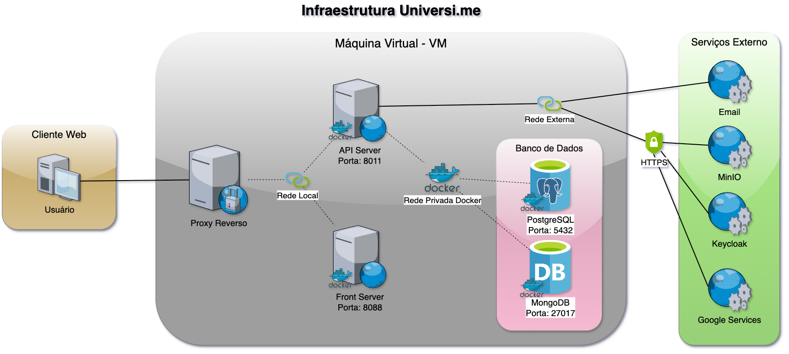

---

# Introdução

O **Universi.me** é uma aplicação web, uma plataforma de desenvolvimento social voltada para o acompanhamento de pessoas, podendo ser utilizada no contexto acadêmico e profissional. A rede social permite que seus usuários compartilhem informações acadêmicas e profissionais, criando redes de pessoas conectadas por projetos ou atividades em comum.

A arquitetura do Universi.me é composta por diversos serviços interconectados: um servidor de API baseado em **Spring Boot**, um **front-end em React e TypeScript**, bancos de dados **PostgreSQL** e **MongoDB**, além de integrações com **MinIO** (armazenamento de imagens) e **Keycloak** (autenticação).

---

## Infraestrutura e Processo de Implantação da Plataforma Universi.me



A infraestrutura é composta por diversos componentes interligados, cada um
com funções específicas que, juntos, garantem o funcionamento integrado da
aplicação. No núcleo do sistema está o **API Server**. Ele é responsável por processar
as requisições vindas do **Cliente Web** e de acessar, quando necessário, via conexão
segura, serviços externos como **MinIO**, **Keycloak**, **Google Services** e **Email**. Para a
persistência dos dados utilizamos o banco de dados **PostgreSQL** e **MongoDB**
comunicando-se através de uma rede interna privada interligada entre si. E para
permitir a comunicação com o usuário, utiliza-se um proxy reverso para redirecionar
e expor os serviços Front e API Server, tornando o acesso público e acessível ao
usuário final.

| Componente | Função |
|-------------|--------|
| API Server | Processa requisições e conecta com serviços externos |
| Front-End | Interface gráfica em React/TypeScript |
| Banco de Dados | PostgreSQL (relacional) e MongoDB (não relacional) |
| Proxy Reverso | Nginx para expor serviços |
| Serviços Externos | MinIO, Keycloak, Google Services, Email |

---

### Serviço do Front

O Front é a camada de interface da aplicação é através dele que os usuários
interagem, desenvolvida em **React**, **TypeScript** e **Docker**, configurado como projeto
**NPM**, o serviço, ao iniciar, fica disponível para acesso via HTTP na porta `5173` em
modo de desenvolvimento e porta `4173` em modo preview (o número da porta pode
se auto incrementar caso a porta esteja em uso no momento). Link do repositório
disponível no GitHub:

Repositório: [github.com/universi-me/universi-front](https://github.com/universi-me/universi-front)

#### Variáveis de Ambiente

As variáveis ambiente do serviço do Front podem ser definidas no processo
de implantação no arquivo `.env`. A tabela a seguir lista as variáveis ambientes e
suas respectivas descrições e valores.

| Variável | Descrição | Valor Padrão |
|-----------|------------|---------------|
| `VITE_UNIVERSIME_API` | Domínio da API utilizada pelo front | `http://localhost:8080/api` |
| `VITE_BUILD_HASH` | Tipo de build (versão atual) | `development` |

---

### Serviço da API

O serviço da API é a camada de comunicação com o Cliente Web,
desenvolvido em **API REST** com **Spring Boot**, **Java** e **Docker**, estruturado como
projeto **Maven**, ao iniciar a aplicação, o serviço fica disponível para acesso via HTTP
na porta padrão `8080`. Link do repositório disponível no GitHub:

Repositório: [github.com/universi-me/universi-api](https://github.com/universi-me/universi-api)

#### Variáveis de Ambiente

Por padrão as variáveis ambiente do serviço da API seguem um padrão de formato começando com `API_`, esse padrão de formato tem a finalidade de localizar e identificar uma variável ambiente configurável. Todas as variáveis ambientais podem ser localizadas no arquivo `application.yml` e definidas durante o processo de implantação no arquivo `.env`. A tabela a seguir lista as variáveis ambientes e suas respectivas descrições e valores.

| Variável | Descrição | Valor Padrão |
|-----------|------------|---------------|
| `API_PROFILE_ACTIVE` | Modo de Execução. Responsável por definir o modo de execução da aplicação (`test`, `dev`, `prod`) | `dev` |
| `API_SERVER_PORT` | Porta utilizada pelo servidor para receber requisições HTTP. | `8080` |
| `API_DB_NAME` | Nome da base de dados. Responsável por definir o nome da base de dados a ser utilizado nos serviços de base de dados. | `universime_api` |
| `API_DB_DOMAIN` | Domínio do banco de dados. Endereço ou domínio onde o banco de dados está hospedado. | `localhost` |
| `API_DB_PORT` | Porta do banco de dados. Porta utilizada para conexão com o banco de dados. | `5432` |
| `API_DB_USER` | Usuário do banco de dados. Nome de usuário para autenticação no banco de dados. | `postgres` |
| `API_DB_PASS` | Senha do banco de dados. Senha de acesso ao banco de dados. | `postgres` |
| `API_DB_MONGO_HOST` | Host do MongoDB. Variável para definir o host do MongoDB. | `API_DB_DOMAIN` |
| `API_LOCAL_ORGANIZATION_ID_ENABLED` | Habilitar ID local de organização. Define se a funcionalidade de organização local está habilitada. | `false` |
| `API_LOCAL_ORGANIZATION_ID` | ID local da organização. Identificador padrão do grupo da organização. | `ccae` |
| `API_RECOVERY_TOKEN_EXPIRATION_HOURS` | Expiração de recuperação de senha. Tempo de expiração do token de recuperação de senha (em horas). | `168` |
| `API_JWT_SECRET_KEY` | Chave secreta do JWT. Define a chave secreta utilizada para assinar tokens JWT. Caso esteja vazio, a plataforma automaticamente gera uma chave secreta randômica a cada inicialização. | `Vazio` |
| `API_JWT_EXPIRATION` | Tempo de expiração do JWT. Tempo de expiração do token JWT em segundos. | `3600` |
| `API_MINIO_ENABLED` | Ativar serviço MinIO. Define se a integração com o serviço de armazenamento MinIO está habilitada. | `false` |
| `API_MINIO_URL` | URL do MinIO. Endereço de acesso ao servidor MinIO. | `http://localhost:9000` |
| `API_MINIO_ACESSKEY` | Chave de acesso MinIO. Chave de acesso (Access Key) do MinIO. | `9JwDwrutRQrywpBFH9ks` |
| `API_MINIO_SECRET` | Chave secreta MinIO. Chave secreta (Secret Key) do MinIO. | `kEtizmyDs70XSm0JVIbLACH2zDv1TOeCawhZ7qWb` |
| `API_MINIO_BUCKET` | Bucket MinIO. Nome do bucket utilizado no MinIO. | `universime` |

---

### Proxy Reverso

O proxy reverso tem um papel de controlar o acesso aos serviços Front e API (back), esse processo consiste em expor uma porta pública que atua como ponto de entrada do sistema.
Essa porta é representada por um socket (IP+porta), que recebe todas as conexões externas. As requisições recebidas nesse socket são então redirecionadas para o socket interno correspondente (porta interna do serviço apropriado), garantindo que o tráfego externo chegue corretamente ao serviço correspondente dentro do ambiente.
O proxy reverso utilizado atualmente é o **Nginx**, por ser o mais popular e apresentar bom desempenho, nele configuramos para expor os dois serviços Front para o caminho `/` e o serviço API para o caminho `/api`.


---

### Banco de dados

Para a persistência dos dados utilizamos bancos de dados distintos a
depender do tipo de dado sendo armazenado. O PostgreSQL e MongoDB são
utilizados, configurados na mesma rede privada do serviço de back (API), porém
também podem ser configurados para serem acessados através de conexão
remota. O **PostgreSQL** é utilizado para dados **relacionais**, como por exemplo
registros de usuários, grupos e dados dos seus perfis. O **MongoDB** é atualmente
utilizado para armazenar informações **não relacionais** como por exemplo dados de
publicações, comentários nas publicações e reações em publicações.

---

### Serviços Externos

Para manter o desempenho, segurança e acessibilidade, o Universi.me
acessa alguns serviços externos para armazenamento de imagens, processo de
autenticação e proteção contra robôs que podem ser utilizados.

#### MinIO
Esse serviço é responsável pelo armazenamento de arquivos de forma
segura e rápida, atualmente utilizado na plataforma para **armazenamento de imagens**, como por exemplo imagens de perfis, imagens de postagens, logos de
grupos e banner de grupos. Acessado externamente em um domínio seguro isolado
da plataforma, garantindo proteção aos dados e desempenho.

#### Keycloak
O **Keycloak** é uma plataforma de gerenciamento de usuários. Ele é utilizado
para o processo de autenticação na plataforma utilizando a tecnologia **OIDC**
(OpenID Connect) em conjunto com o processo de autenticação Flow, onde a
plataforma envia o usuário para a página de autenticação do serviço Keycloak e
assim que for autenticado o usuário recebe um token e é redirecionado de volta
para a plataforma para concluir o processo de autenticação e permitir o acesso ao
Universi.me. Este serviço é opcional e pode ser configurado no painel de
configurações da plataforma Universi.me. Quando este serviço não está em uso, os
usuários são autenticados na API usando tokens **JWT** (Json Web Tokens).

#### Email
O serviço de email é utilizado para a funcionalidade de envio de notificações
da plataforma e recuperação de conta via e-mail. Esse serviço se conecta a um
servidor **SMTP/SMTPS** (Simple Mail Transfer Protocol) externo para envio de
emails. O serviço pode ser configurado através do painel de configurações da
plataforma Universi.me.

#### Google Services
O Google Services é utilizado opcionalmente para a funcionalidade de
autenticação da plataforma através da ação **entrar via conta Google** e também é utilizada a funcionalidade **reCaptcha Enterprise** opcionalmente para a proteção dos
formulários públicos na plataforma como o Login, Cadastrar-se e Recuperação de
Conta.

---

## Implantação da Plataforma

Para a implantação da plataforma iremos considerar uma **VM** (Máquina
Virtual) dedicada para utilizarmos no ambiente de trabalho. Essa VM atua como um
**servidor isolado**, para podermos gerenciar os recursos necessários para
implantação.

### Instalação das Dependências

Para prosseguir com o processo de implantação da plataforma é necessário
instalar algumas dependências no servidor principal (ou VM) que iremos utilizar para
o ambiente de trabalho. Para podermos ter a possibilidade de, por exemplo,
orquestrar containers, serviço de proxy reverso, clonar repositórios e editar arquivos
via terminal.

Execute o seguinte comando para instalar as dependências necessárias
(`Docker`, `docker-compose`, `Nginx`, `Git` e `nano`) utilizando o gerenciador de pacotes
APT:
```bash
sudo apt update
```
```bash
sudo apt install docker docker-compose nginx git nano
```

### Clonar Repositórios

Após a instalação das dependências, iremos criar uma pasta de trabalho para
clonar o repositório localmente, utilizamos o comando git clone especificando o
repositório da API:
```bash
git clone https://github.com/universi-me/universi-api.git
```

e depois para clonar localmente o Front utilizamos o comando:
```bash
git clone https://github.com/universi-me/universi-front.git
```

### Configurando e iniciando o serviço API

Navegamos para a pasta do repositório `universime-api` e para
configurarmos as variáveis ambientes de acordo com as necessidades, para
definirmos as variáveis ambiente podemos utilizar o arquivo `.env`, para editar
utilizamos o comando:
```bash
cd universi-api
```
```bash
nano .env
```

Após editamos as variáveis salvamos utilizando Control+X.


Por padrão no arquivo de configuração do docker-compose
`docker-compose.yml` a porta exposta para o serviço da API é `8011`, podendo ser
alterada utilizando o comando:
```bash
nano docker-compose.yml
```

Antes de iniciarmos a API precisamos fazer o build da imagem utilizando o
comando:
```bash
docker-compose build --no-cache
```

Depois, caso o serviço da API já esteja ativo anteriormente:
```bash
docker-compose stop
```

Para iniciarmos o serviço em background utilizamos o comando:
```bash
docker-compose up -d
```

---

### Configurando e iniciando o serviço Front

Para o Front, o processo é semelhante ao do serviço da API. Navegamos
para a pasta do projeto `universi-front`, editamos as variáveis de ambiente no
arquivo `.env` através do comando:
```bash
cd universi-front
```
```bash
nano .env
```

Após editamos as variáveis salvamos utilizando Control+X.


Por padrão a porta exposta do serviço é `8088`, podendo ser alterada pelo
comando:
```bash
nano docker-compose.yml
```

Depois fazemos o build com o comando:
```bash
docker-compose build --no-cache
```

Paramos o serviço caso já esteja ativo:
```bash
docker-compose stop
```

E iniciamos o serviço com o seguinte comando:
```bash
docker-compose up -d
```

---

### Configurando o Nginx

Para configurar o **Nginx** criamos um novo arquivo de configuração através do
comando:
```bash
sudo nano /etc/nginx/sites-available/universi.me
```

Em seguida configuramos o proxy reverso para o serviço API o caminho
`/api` para a porta escolhida, que no nosso caso é `8011` e para o serviço do Front o
caminho `/` para a porta escolhida `8088`, um exemplo de configuração mostrado na
figura abaixo.

``` nginx linenums="1"
server {
    listen 80;
    server_name universi.me;

    location / {
        proxy_pass http://localhost:8088;
		proxy_redirect off;
		proxy_set_header Host $host;
		proxy_set_header X-Real-IP $remote_addr;
		proxy_set_header X-Forwarded-For $proxy_add_x_forwarded_for;
        proxy_set_header X-Forwarded-Proto $scheme;
    }

    location /api/ {
        proxy_pass http://localhost:8011;
		proxy_redirect off;
		proxy_set_header Host $host;
		proxy_set_header X-Real-IP $remote_addr;
		proxy_set_header X-Forwarded-For $proxy_add_x_forwarded_for;
        proxy_set_header X-Forwarded-Proto $scheme;
    }
}
```

Após salvar o arquivo, precisamos habilitar utilizando o seguinte comando
para criar um link simbólico:
```bash
sudo ln -s /etc/nginx/sites-available/universi.me /etc/nginx/sites-enabled/
```

Em seguida reiniciamos o serviço Nginx para aplicar as alterações através do
comando:
```bash
sudo systemctl reload nginx
```

---

## Problemas comuns, soluções e dicas

### Desempenho do Sistema

O serviço da API pode apresentar problemas de desempenho. Para verificar
se o desempenho é um problema, podemos utilizar uma ferramenta de inspeção
como por exemplo a ferramenta Web DevTools no navegador Web Chrome. Ao usar
essa ferramenta, na aba de rede, podemos visualizar todas as requisições feitas a
partir do cliente web para o serviço da API. Na coluna tempo podemos ver o tempo
de execução de cada requisição: se esse valor for elevado como por exemplo 1
segundo ou mais podemos caracterizar em um possível problema de desempenho,
podemos considerar o valor ideal de tempo de resposta como sendo abaixo de 1
segundo, quanto menor esse tempo melhor.


Para identificar esse problema podemos analisar primeiramente algumas
classes que têm uma interação frequente durante a execução do sistema, como por
exemplo as classes User, Profile e Group. Os atributos que são compostos dessas
classes, como por exemplo do tipo listagens, são aconselháveis sempre utilizar
anotações com o tipo de carregamento dos valores em banco com atraso
(FetchType.LAZY), assim essas entidades são carregadas rapidamente e
possibilitando obter os valores de seus atributos no banco de dados quando
realmente for necessário, acessado pelo método get de seu atributo, como por
exemplo que ocorre durante uma serialização Json para construir a resposta para a
aplicação do cliente web. O trecho de código a seguir mostra um exemplo de
utilização da anotação com o tipo de carregamento em atraso em um atributo do
tipo lista:

``` java linenums="1"
@OneToMany(mappedBy = "profile", fetch = FetchType.LAZY)
private Collection<Link> links;
```

Caso precise reproduzir a lentidão em uma máquina local de
desenvolvimento, precisamos obter ou criar uma database semelhante ou
volumosa com muitos dados inseridos para testes. Reproduzindo o problema
localmente facilita no processo de identificação e correção do problema.

### Problemas de Inicialização

O serviço da API pode falhar durante a inicialização por vários motivos, é
importante analisarmos o log de inicialização para identificar o problema
relacionado.

Uma falha comum que pode ocorrer é problema na comunicação com o
banco de dados caso o serviço do banco de dados não esteja disponível ou
configurado incorretamente nas variáveis ambiente do serviço da API como o
domínio ou porta especificada incorretamente causando falha de conexão recusada.

Pode também ocorrer falha de migração na database durante a inicialização,
podemos enfrentar esse problema quando utilizamos uma diversidade de
implantações e quando atualizamos a versão do serviço da API em uma
implantação podemos enfrentar erros no script de migração que é executado
durante a inicialização, para corrigir verificamos o log de inicialização para identificar
o nome do script de migração e o erro relacionado que causou a falha de migração
para localizar e solucionar o problema.


### Release de Uma Nova Versão

No repositório do serviço tanto da API quanto do Front, possui um Workflow
do Github Actions que é executado automaticamente quando publicamos uma
Release podendo ser acompanhado o progresso na aba Actions do repositório, esse
script de workflow é responsável por fazer um build de uma imagem docker e
publicar no Registry do Github, esses imagens ficam disponiveis em:
[https://github.com/orgs/universi-me/packages](https://github.com/orgs/universi-me/packages)

Essas imagens servem para facilitar o deploy do serviço utilizando apenas a
imagem docker, podendo ter a possibilidade de por exemplo utilizarmos a imagem
para um deploy em Kubernetes.

---
